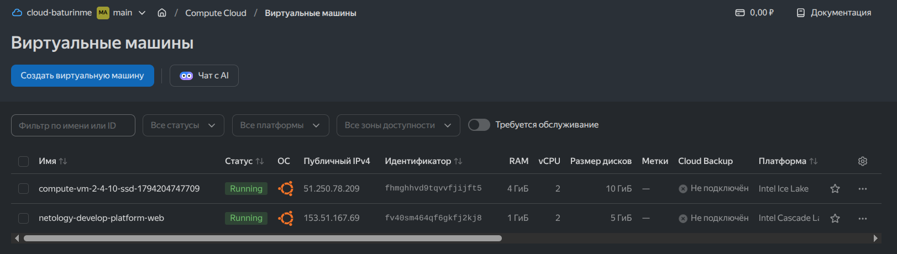

# Ответ к заданию «Введение в Terraform» - hw-01.md

### Задание 1

1. Ответ не требуется.

2. Создал аккаунт командой `yc iam service-account create --name terraform-sa`
Создал ключ командой `yc iam key create --service-account-id aje6fo34bv75cvlh0oej --output ~/.config/yandex-cloud/terraform-sa-key.json`

3. Посмотрел SSH-ключ командой `cat ~/.ssh/id_ed25519.pub` и записал его в variables.tf: 
```
variable "vms_ssh_public_root_key" {
  type        = string
  default     = "ssh-ed25519 AAAAC3N..."
  description = "ssh-keygen -t ed25519"
}
```

4. Инициализировал проект с помощью `terraform init`. Проверил корректность кода с помощью `terraform validate`. Исправил имя переменной SSH-ключа: vms_ssh_root_key заменено на vms_ssh_public_root_key, чтобы оно соответствовало объявлению в variables.tf. Исправил в main.tf `standart` на `standard`, так как первый вариант содержит не является корректным идентификатором.

5. Подключился к виртуальной машине командой `ssh ubuntu@153.51.167.69`

#### Личный кабинет в Yandex.Cloud


#### Отображение ip-адреса


6. Параметр preemptible = true делает виртаульную машины прерываемой. Она дешевле, но может быть автоматически остановлена Yandex Cloud.

Параметр core_fraction = 5 позволяет выделить виртуальной машине 5% гарантированной вычислительной мощности одного виртуального ядра, что также снижает стоимость и подходит для задач, не требующих высокой производительности процессора.