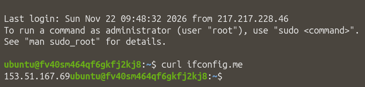
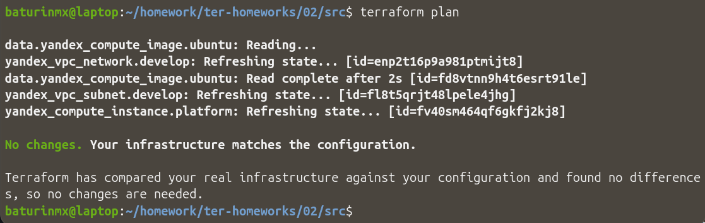
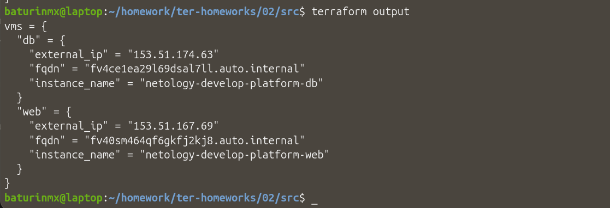

# Ответ к заданию «Основы Terraform. Yandex Cloud»

### Задание 1

1. Ответ не требуется.

2. Создал аккаунт командой `yc iam service-account create --name terraform-sa`
Создал ключ командой `yc iam key create --service-account-id aje6fo34bv75cvlh0oej --output ~/.config/yandex-cloud/terraform-sa-key.json`

3. Посмотрел SSH-ключ командой `cat ~/.ssh/id_ed25519.pub` и записал его в variables.tf: 
```
variable "vms_ssh_public_root_key" {
  type        = string
  default     = "ssh-ed25519 AAAAC3N..."
  description = "ssh-keygen -t ed25519"
}
```

4. Инициализировал проект с помощью `terraform init`. Проверил корректность кода с помощью `terraform validate`. Исправил имя переменной SSH-ключа: vms_ssh_root_key заменено на vms_ssh_public_root_key, чтобы оно соответствовало объявлению в variables.tf. Исправил в main.tf `standart` на `standard`, так как первый вариант содержит не является корректным идентификатором.

5. Подключился к виртуальной машине командой `ssh ubuntu@153.51.167.69`

#### Личный кабинет в Yandex.Cloud


#### Отображение ip-адреса


6. Параметр preemptible = true делает виртаульную машины прерываемой. Она дешевле, но может быть автоматически остановлена Yandex Cloud.

Параметр core_fraction = 5 позволяет выделить виртуальной машине 5% гарантированной вычислительной мощности одного виртуального ядра, что также снижает стоимость и подходит для задач, не требующих высокой производительности процессора.

### Задание 2

1. main.tf после замены переменных:
```
resource "yandex_vpc_network" "develop" {
  name = var.vpc_name
}

resource "yandex_vpc_subnet" "develop" {
  name           = var.vpc_name
  zone           = var.default_zone
  network_id     = yandex_vpc_network.develop.id
  v4_cidr_blocks = var.default_cidr
}

data "yandex_compute_image" "ubuntu" {
  family = var.vm_web_image_family
}

resource "yandex_compute_instance" "platform" {
  name        = var.vm_web_name
  platform_id = var.vm_web_platform_id

  resources {
    cores         = var.vm_web_cores
    memory        = var.vm_web_memory
    core_fraction = var.vm_web_core_fraction
  }

  boot_disk {
    initialize_params {
      image_id = data.yandex_compute_image.ubuntu.image_id
    }
  }

  scheduling_policy {
    preemptible = true
  }

  network_interface {
    subnet_id = yandex_vpc_subnet.develop.id
    nat       = true
  }

  metadata = {
    serial-port-enable = 1
    ssh-keys           = "ubuntu:${var.vms_ssh_public_root_key}"
  }
}
```

2. В variables.tf добавленые следующие переменные:

```
variable "vm_web_image_family" {
  type    = string
  default = "ubuntu-2004-lts"
}

variable "vm_web_name" {
  type    = string
  default = "netology-develop-platform-web"
}

variable "vm_web_platform_id" {
  type    = string
  default = "standard-v2"
}

variable "vm_web_cores" {
  type    = number
  default = 2
}

variable "vm_web_memory" {
  type    = number
  default = 1
}

variable "vm_web_core_fraction" {
  type    = number
  default = 5
}
```

3. `terraform plan` без изменений



### Задание 3

1. Созданал файл и записал в него переменные командой `nano vms_platform.tf`

2. Получившиеся переменные в файле vms_platform.tf: 

```
variable "vm_db_name" {
  type    = string
  default = "netology-develop-platform-db"
}

variable "vm_db_platform_id" {
  type    = string
  default = "standard-v2"
}

variable "vm_db_cores" {
  type    = number
  default = 2
}

variable "vm_db_memory" {
  type    = number
  default = 2
}

variable "vm_db_core_fraction" {
  type    = number
  default = 20
}

variable "vm_db_zone" {
  type    = string
  default = "ru-central1-d"
}
```

3. Применение изменений выполнил командой `terraform apply`

### Задание 4

#### Результат выполнения команды terraform output


### Задание 5

Содержимое файла locals.tf:
```
locals {
  vm_web_name = "${var.vm_web_name}"
  vm_db_name  = "${var.vm_db_name}"
}
```

В main.tf в следующих блоках кода var.vm_..._name были изменены на local.vm_..._name
```
resource "yandex_compute_instance" "platform" {
  name        = local.vm_web_name
  platform_id = var.vm_web_platform_id
...
resource "yandex_compute_instance" "platform_db" {
  name        = local.vm_db_name
```

### Задание 6

1. Объединил три переменные vm_web_cores, vm_web_memory, vm_web_core_fraction и аналогичные переменные для DB в единую map-переменную vms_resources, создав её в файле vms_platform.tf и добавив следующий код:
```
variable "vms_resources" {
  type = map(object({
    cores         = number
    memory        = number
    core_fraction = number
  }))

  default = {
    web = {
      cores         = 2
      memory        = 1
      core_fraction = 5
    }
    db = {
      cores         = 2
      memory        = 2
      core_fraction = 20
    }
  }
}
```

2. Создал и использовал отдельную map-переменную metadata для блока метаданных, общую для обеих ВМ, в файле variables.tf, добавив следующий код:
```
variable "metadata" {
  type = map(string)

  default = {
    serial-port-enable = "1"
    ssh-keys           = "ubuntu:ssh-ed25519 AAAAC3Nza..."
  }
}
```

3. В файле main.tf заменил обращения к отдельным переменным ресурсов на обращения к элементам map-переменной vms_resources: 
```
resources {
  cores         = var.vms_resources["web"].cores
  memory        = var.vms_resources["web"].memory
  core_fraction = var.vms_resources["web"].core_fraction
}
...
resources {
  cores         = var.vms_resources["db"].cores
  memory        = var.vms_resources["db"].memory
  core_fraction = var.vms_resources["db"].core_fraction
}
```
Закомментировал все более не используемые переменные в файлах vms_platform.tf и variables.tf: vm_web_cores, vm_web_memory, vm_web_core_fraction, vm_db_cores, vm_db_memory, vm_db_core_fraction, vms_ssh_public_root_key

4. Проверил конфигурацию с помощью команды terraform plan.

`No changes. Your infrastructure matches the configuration.`
